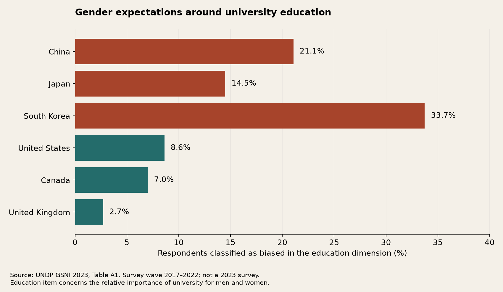
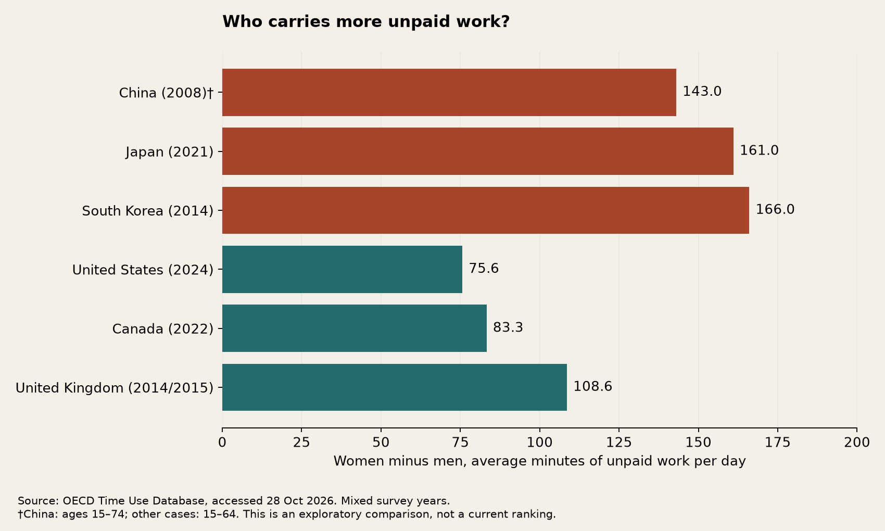

# Life on the Other Side Final Project Data

**Nicole Lu · Data Visualization for Architecture, Urbanism, and the Humanities · October 28, 2026**  
Assignment due October 29, 2026. [Assignment requirements](https://jjjiia.github.io/data_visualization_2026/assignments.html#final-project-data).

## Research question and scope

**How do expectations, institutions, and everyday conditions shape growing up in China, Japan, South Korea, the United States, Canada, and the United Kingdom?**

This project follows a life journey through gender expectations, school, food, work, money, migration, and family. East–West differences motivate the questions, but the six countries remain separate cases. The data can describe contrasts and challenge familiar impressions. They cannot isolate culture as the cause of those contrasts or represent every person within a country.

The acquired foundation includes six source collections: World Bank indicators, UNDP gender attitudes, OECD time use, OECD wages, an OpenStreetMap restaurant pilot, and an independently coded marriage milestone table. The final story will need additional evidence about curriculum choice, marriage registrations, and social acceptance. These are identified below rather than represented by invented values or unrelated proxies.

## Data acquisition and project coverage

All source access dates are **2026-10-28**. Retained downloads total **5.83 MiB**, small enough to store and analyze locally. Exact URLs, sizes, and SHA-256 checksums are in the [download manifest](data/download_manifest.json) and [restaurant query manifest](data/osm_manifest.json). Downloaded source files are in [data/raw](data/raw); cleaned tables are in [data/processed](data/processed). The marriage table is an original factual compilation in [data/curated](data/curated).

| Story chapter | Acquired evidence | What remains unresolved |
| --- | --- | --- |
| Expectations from childhood | UNDP educational/economic gender attitudes, total and by respondent sex | Survey answers describe beliefs, not an individual child's treatment; within-country age/income breakdowns require microdata |
| School and future paths | World Bank tertiary enrollment, including female and male series | Enrollment does not count available subjects or majors; code actual curriculum and admissions rules separately |
| Food and everyday exposure | Restaurant objects and cuisine tags in six 2 km radius city samples | Mapping completeness, cuisine taxonomy and actual consumption; pilot is not a national food-diversity ranking |
| Work and time autonomy | OECD paid work/study, unpaid work, leisure, personal care and other time; labor participation | Different years and ages; paid work/study is not overtime, and residual leisure is not a direct autonomy measure |
| Earnings and living costs | OECD full-time-equivalent annual wages; World Bank consumption PPP and exchange rates | China missing from wage series; taxes, housing and household circumstances not captured |
| Migration and encounters | International migrant stock share | Stock is not annual inflow, citizenship, ethnic diversity or cuisine exposure |
| Relationships and family | Five marriage-law milestones; fertility and aging context | Asian legal cases, registration counts, age at marriage and acceptance data still require collection |

## Source catalog and permissions

### World Bank World Development Indicators

**Producer:** World Bank, compiling partner organizations and national agencies; indicator-level producers and definitions are preserved in the [dictionary](data/processed/wdi_indicator_dictionary.csv).  
**Source:** [WDI](https://databank.worldbank.org/source/world-development-indicators), [API documentation](https://datahelpdesk.worldbank.org/knowledgebase/articles/889392-about-the-indicators-api-documentation). The manifest contains each exact six-country API request.  
**Contents:** 13 successful series on labor participation, education, consumption PPP, exchange rates, income context, migration, fertility, aging, inequality and population sex composition. One additional attempted price indicator was rejected by the API and excluded.  
**Size:** 13 JSON data responses, each with 156 country–year slots, plus 13 metadata responses; [clean panel](data/processed/wdi_country_year.csv) has **2,028 rows × 11 columns**, including missing values.  
**Row:** one country, year and indicator. Primary key: `iso3 + year + indicator`.  
**Coverage:** all six countries, requested years 2000–2025; actual observed years vary by series. [Coverage by country and series](analysis/wdi_coverage.csv).  
**Updated:** API reports 2026-10-08. Next update date is not provided; future releases may revise historical values.  
**License:** CC BY 4.0 default for World Bank open datasets, subject to its additional terms and provider-specific exceptions. Copying, adaptation, redistribution and commercial reuse require attribution and a change notice. [World Bank terms](https://datacatalog.worldbank.org/public-licenses), [CC BY 4.0](https://creativecommons.org/licenses/by/4.0/). No additional restriction was identified in the downloaded indicator metadata. Credit both World Bank and the original provider listed for each indicator. These are aggregate indicators, not restricted microdata.  
**Project transformation:** six-country selection, 2000–2025 window, tidy CSV conversion, common-year selection and a separately labeled derived consumption price index. Raw JSON remains unchanged.

### UNDP Gender Social Norms Index 2023

**Producer:** UNDP Human Development Report Office, calculated from World Values Survey responses.  
**Source:** [Publication and download page](https://hdr.undp.org/content/2023-gender-social-norms-index-gsni), [original Excel](https://hdr.undp.org/sites/default/files/publications/additional-files/2023-06/GSNI2023_AnnexTables2.xlsx), [technical note](https://hdr.undp.org/sites/default/files/publications/additional-files/2023-06/gsni_2023_technical_note.pdf).  
**Contents:** published country percentages for bias in political, educational, economic and physical-integrity dimensions, and composite measures. The six-country extract uses Table A1 totals and Table A2 women/men.  
**Size:** original workbook has six sheets; [clean extract](data/processed/gender_social_norms.csv) has **18 rows × 12 columns**.  
**Row:** one country and respondent-sex group, with seven percentage measures. Primary key: `iso3 + sex`.  
**Coverage:** six countries × Total/Women/Men; all selected observations are assigned to the WVS **2017–2022 wave**, not one common survey year.  
**Updated:** published June 12, 2023; source data cutoff January 12, 2023. Next GSNI release date was not stated on the source page.  
**License:** [UNDP terms](https://hdr.undp.org/terms-use), [CC BY 3.0 IGO](https://creativecommons.org/licenses/by/3.0/igo/). Sharing, adaptation and commercial use are allowed with attribution, license link and identification of changes; do not imply UNDP endorsement. The downloadable aggregates are used here; WVS respondent microdata are not redistributed.  
**Attribution:** UNDP (2023), *2023 Gender Social Norms Index*, Tables A1–A2, accessed October 28, 2026. Adaptation: selected countries, standardized country names and column names.

### OECD Time Use Database

**Producer:** OECD, harmonizing national time-use surveys.  
**Source:** [Database and methods](https://www.oecd.org/en/data/datasets/time-use-database.html), [SDMX CSV](https://sdmx.oecd.org/public/rest/v1/data/OECD.WISE.INE,DSD_TIME_USE@DF_TIME_USE,1.0/all?format=csvfile), [detailed workbook with survey years and ages](https://www.oecd.org/content/dam/oecd/en/data/datasets/time-use-database/OECD-time-use-database-updates.xlsx).  
**Contents:** daily minutes in five activity groups, by sex.  
**Size:** original CSV **525 rows × 9 columns**; [project extract](data/processed/time_use.csv) **90 rows × 14 columns** after adding country, activity, sex labels, survey period and age reference.  
**Row:** one country × activity × sex. Primary key: `REF_AREA + MEASURE + SEX`.  
**Updated:** source page/workbook lists April 30, 2026 as its latest update. Next update is not scheduled on the page. Survey periods are much older than the database update.  
**License:** [OECD terms, section 3](https://www.oecd.org/en/about/terms-conditions.html). OECD permits extraction, adaptation and redistribution, including commercial use, with attribution and propagation of that attribution requirement, except where third-party restrictions apply. No extra restriction was found in the inspected download; retain national-survey credits. This is not labeled public domain or automatically CC BY 4.0.  
**Attribution:** OECD (2026), Time Use Database, national time-use surveys, accessed October 28, 2026. Changes: six-country selection, joined survey metadata and calculated gender gaps.

| Country | Survey period | Ages |
| --- | --- | --- |
| Canada | 2022 | 15-64 |
| Japan | 2021 | 15-64 |
| South Korea | 2014 | 15-64 |
| United Kingdom | 2014/2015 | 15-64 |
| United States | 2024 | 15-64 |
| China | 2008 | 15-74 |

**China's age range is an exception to the general OECD harmonization description.** The detailed workbook explicitly says 15–74. China is retained as an annotated historical case, not silently treated as a comparable 2024 survey. The newer [China 2024 national survey](https://www.stats.gov.cn/xxgk/sjfb/zxfb2020/202410/t20241031_1957217.html) is a follow-up candidate; it is not merged here.

### OECD Average Annual Wages

**Producer:** OECD, using national accounts and labor statistics.  
**Source:** [Definition](https://www.oecd.org/en/data/indicators/average-annual-wages.html), [CSV download](https://sdmx.oecd.org/public/rest/v1/data/OECD.ELS.SAE,DSD_EARNINGS@AV_AN_WAGE,1.0/all?startPeriod=2000&endPeriod=2025&format=csvfile).  
**Contents:** annual average wage per dependent employee, adjusted to full-time equivalent.  
**Size:** downloaded CSV **3,103 rows × 14 columns** with multiple currencies/price bases; [selected series](data/processed/annual_wages_ppp.csv) **130 rows × 15 columns**.  
**Row:** one country–year after filtering `UNIT_MEASURE=USD_PPP`, `PRICE_BASE=Q`. Primary key: `REF_AREA + TIME_PERIOD`.  
**Coverage:** Japan, South Korea, US, Canada and UK; 2000–2025. China has no observation in this selected series. All selected observations have base year 2025.  
**Updated:** exact dataset revision date not exposed in this CSV; latest observation is 2025. Do not confuse that with an update date. Annual series; exact next release not verified.  
**License:** OECD data terms, as above; same attribution and third-party caveats.  
**Attribution:** OECD (2026), Average Annual Wages, accessed October 28, 2026. Changes: country selection and consistent PPP/constant-price series. These are gross mean wages, not median wages or after-tax household income. The PPP-adjusted values should not be divided by the relative price index again.

### OpenStreetMap restaurant pilot

**Producer:** OpenStreetMap contributors; accessed through the public Overpass API.  
**Source:** [OSM](https://www.openstreetmap.org), [saved queries and centers](data/osm_manifest.json). Each query requests objects tagged `amenity=restaurant` within 2,000 m of an analyst-selected point.  
**Contents:** OSM object type/ID, name, unaltered cuisine tag, representative coordinates and extract metadata.  
**Size:** six raw JSON files; [clean table](data/processed/restaurant_pilot.csv) has **10,478 rows × 12 columns**.  
**Row:** a mapped restaurant object, not a verified unique business. Primary key: `city + osm_type + osm_id`. Node/way representations of the same business may remain as semantic duplicates.  
**Coverage:** six small areas in Beijing, Tokyo, Seoul, New York, Toronto and London; these are convenience samples, not whole cities or countries. Centers and radius are explicit in every row and the manifest. Way/relation coordinates are representative centers; Overpass inclusion does not guarantee that every returned center lies within the radius.  
**Updated:** continuously edited database; each response's `timestamp_osm_base` is preserved as `snapshot_utc`. No fixed next release.  
**License:** [OSM copyright](https://www.openstreetmap.org/copyright), [ODbL 1.0](https://opendatacommons.org/licenses/odbl/1-0/). Redistribution and commercial use are allowed with attribution and share-alike obligations for adapted databases. Raw OSM extracts, the restaurant CSV and its tabulated derivatives remain under ODbL 1.0. Keep this database separate from the other source collections.  
**Attribution:** © OpenStreetMap contributors, ODbL 1.0. Changes: geographic/tag selection, flattening, and splitting semicolon-delimited cuisine tags for exploratory counts. These transformations do not assign cuisines to national identities.

### Marriage equality milestones

**Producer:** Nicole Lu project compilation from Canadian legislation, the US Supreme Court decision, UK Government and Scottish Government publications. [Five-row dataset and source links](data/curated/marriage_milestones.csv).  
**Contents and size:** **5 rows × 10 columns**, each a dated legal/availability event in one jurisdiction. Dates are encoded as ISO `YYYY-MM-DD`; the event type distinguishes royal assent, court decision and marriage availability.  
**Coverage:** Canada, United States, and three UK jurisdictions, 2005–2020. China, Japan and South Korea are uncollected in this pilot, not coded as zero. This is not an exhaustive legal-status history.  
**Updated:** project compilation October 28, 2026; no scheduled next update. Underlying documents are dated historical records, with exact dates/source citations retained.  
**Rights:** original factual selection and paraphrased descriptions, with links to source documents rather than copies of their text. Government source content retains its own terms: [UK Open Government Licence](https://www.nationalarchives.gov.uk/doc/open-government-licence/version/3/), [Canada Justice reproduction terms](https://www.canada.ca/en/transparency/terms.html). US court opinions are US government works; site editorial material is not reproduced. No blanket open license is assigned to the original project writing or compilation.  
**Use:** a contextual timeline, not a numerical scale of acceptance or a measure of LGBTQ+ population size.

## Data structure and dictionary

CSV files are UTF-8 with one header row. Blank numeric values represent missing observations, never zero. Codes and date ranges remain text; annual years are integers; measured values are floating-point numbers. No East/West average or overall cultural score is constructed.

| Table | Important columns and types |
| --- | --- |
| WDI panel | `iso3`, `country`, `indicator`, `indicator_name`: text; `year`: integer; `value`: nullable float; `unit`, `obs_status`: original API text, often blank; `source_id`: source code; `source_updated`, `accessed`: ISO date strings |
| WDI dictionary | Indicator code, name, full definition, producer, update date and source URL; the indicator name/definition provides units where API `unit` is blank |
| Common-year panel | WDI fields plus integer `comparison_year`; one latest year with nonmissing data for all six countries, selected separately per indicator |
| Price levels | `consumption_ppp_lcu_per_int_dollar`, `exchange_lcu_per_usd`, `ppp_exchange_ratio`, `relative_price_level_us_100`: floats; country/year key |
| GSNI | `iso3`, `country`, `sex`, `survey_period`: text; UK exception: boolean; seven fields ending `_pct`: floats on a 0–100 scale |
| Time use | `REF_AREA`, `MEASURE`, `SEX`: codes; `OBS_VALUE`: minutes/day; `DECIMALS`, `UNIT_MULT`: integers; `OBS_STATUS`: retained quality/status code; `UNIT_MEASURE=MN_D`; added labels, survey-period and age-range strings |
| Wages | Country/year key; `OBS_VALUE`: annual wage; `UNIT_MEASURE=USD_PPP`, `PRICE_BASE=Q`, `PAY_PERIOD=A`, `AGGREGATION_OPERATION=MEAN`, `SEX=_Z`; `BASE_PER=2025`; `_Z` is not a male/female subgroup |
| Restaurant pilot | `iso3`, `city`, `osm_type`, `name`, `cuisine_raw`: text; `osm_id`: integer; `lat`, `lon`, `center_lat`, `center_lon`: WGS84 decimal degrees; `radius_m`: integer; `snapshot_utc`: timestamp |
| Marriage milestones | Country/jurisdiction/event/source fields: text; `event_date`, `accessed`: ISO date strings. See row-level `coverage_note` before comparing dates |

The [OECD SDMX structure](data/raw/oecd_time_structure.xml) preserves the original activity/status code definitions. All columns in all selected tables are enumerated in the [machine-readable inventory](analysis/inventory.json).

### Derived variables

**Unpaid work gap:** women's mean daily unpaid-work minutes minus men's, within the same country's survey. Total, female and male groups are not independent samples and are not pooled together.

**Consumption price level:** `(consumption PPP / official exchange rate) / (US consumption PPP / US official exchange rate) × 100`, aligned by year. The source inputs are in local currency per international dollar and local currency per US dollar. Raw exchange rates and raw PPP conversion factors are not averaged across currencies. The resulting index describes a broad private-consumption price level; it is not a city rent index, a personal budget, or a direct measure of affordability.

**Cuisine counts:** preserve `cuisine_raw`, then split on semicolons, trim whitespace and lowercase for tag-frequency summaries. One object may contribute more than one tag. No inference of country of origin and no count of “foreign” cuisines is made.

## Descriptive statistics

Numeric statistics use the latest common observed year separately for each WDI indicator, the 2025 five-country wage snapshot, or the stated cross-sectional survey values. They describe variation among selected country estimates with equal weights, not a population-weighted typical person. Standard deviation is the sample SD (`ddof=1`); percentiles use linear interpolation. Outlier flags use 1.5 × IQR. With only five or six values, skewness and outlier flags are exploratory, not evidence of measurement error or significance.

### Numeric summaries

| variable | n | minimum | maximum | mean | median | range | sample_sd | p25 | p75 |
| --- | --- | --- | --- | --- | --- | --- | --- | --- | --- |
| GDP per capita, PPP (constant 2021 international $) | 6 | 25,066.52 | 76,931.31 | 52,993.50 | 54,845.10 | 51,864.79 | 16,783.26 | 49,710.81 | 57,416.46 |
| Tertiary gross enrollment (%) | 6 | 63.38 | 102.81 | 79.29 | 79.11 | 39.44 | 13.16 | 73.40 | 79.67 |
| Female tertiary gross enrollment (%) | 6 | 62.41 | 94.85 | 85.69 | 92.34 | 32.44 | 13.08 | 81.32 | 93.98 |
| Male tertiary gross enrollment (%) | 6 | 64.29 | 110.49 | 73.26 | 66.33 | 46.20 | 18.28 | 64.98 | 67.26 |
| Gini index (0–100) | 6 | 29.90 | 40.00 | 34.12 | 32.70 | 10.10 | 3.70 | 32.40 | 36.00 |
| Female labor force participation, 15+ (%) | 6 | 55.91 | 60.20 | 57.62 | 57.06 | 4.30 | 1.70 | 56.45 | 58.69 |
| Male labor force participation, 15+ (%) | 6 | 65.60 | 72.00 | 69.15 | 69.39 | 6.41 | 2.49 | 67.53 | 71.07 |
| International migrant stock (% of population) | 6 | 0.10 | 22.20 | 10.15 | 9.35 | 22.10 | 9.15 | 2.97 | 16.62 |
| Fertility (births per woman) | 6 | 0.75 | 1.63 | 1.22 | 1.20 | 0.88 | 0.33 | 1.05 | 1.48 |
| Population age 65+ (%) | 6 | 14.91 | 29.99 | 20.60 | 19.98 | 15.08 | 5.03 | 18.72 | 20.31 |
| Female population (%) | 6 | 49.09 | 51.24 | 50.22 | 50.23 | 2.15 | 0.75 | 49.84 | 50.65 |
| Consumption price level (US=100) | 6 | 48.12 | 100.00 | 76.93 | 79.60 | 51.88 | 20.32 | 63.67 | 91.82 |
| Gender bias in education (%) | 6 | 2.71 | 33.73 | 14.61 | 11.56 | 31.03 | 11.34 | 7.42 | 19.42 |
| Gender bias in economic life (%) | 6 | 10.37 | 65.54 | 33.26 | 26.64 | 55.17 | 23.60 | 14.49 | 51.62 |
| Unpaid work (minutes/day) | 6 | 125.00 | 205.29 | 169.59 | 179.21 | 80.29 | 34.96 | 139.75 | 196.47 |
| Leisure (minutes/day) | 6 | 211.27 | 305.53 | 258.63 | 263.63 | 94.26 | 34.49 | 235.45 | 277.14 |
| Paid work or study (minutes/day) | 6 | 262.26 | 368.00 | 321.61 | 338.36 | 105.74 | 41.58 | 292.89 | 343.28 |
| Unpaid work female-minus-male gap (min/day) | 6 | 75.59 | 166.01 | 122.90 | 125.78 | 90.42 | 39.32 | 89.58 | 156.50 |
| Annual wages (2025 USD PPP) | 5 | 50,182.65 | 86,977.14 | 66,523.74 | 66,299.14 | 36,794.49 | 13,370.07 | 61,259.16 | 67,900.60 |
| Restaurants missing cuisine tags (%) | 6 | 19.04 | 89.37 | 43.69 | 35.90 | 70.32 | 24.85 | 30.73 | 48.66 |

Full precision, skewness, outlier counts and the population/time basis for every row are in [descriptive_statistics.csv](analysis/descriptive_statistics.csv). The separate units must not be combined. Fertility estimates are period births per woman, not observed completed family size. Tertiary enrollment is a gross ratio, so values above 100% can be valid.

### Gender expectations

| Country | Education bias (%) | Economic bias (%) |
| --- | --- | --- |
| Canada | 7.02 | 16.25 |
| China | 21.07 | 56.49 |
| Japan | 14.49 | 37.03 |
| South Korea | 33.73 | 65.54 |
| United Kingdom | 2.71 | 10.37 |
| United States | 8.62 | 13.90 |

The educational item measures whether respondents prioritize university education for men over women. It does not measure university access or actual subject choice. Among these six published wave estimates, education bias ranges from 2.71% in the UK to 33.73% in South Korea. Japan, China and South Korea differ substantially, giving the narrative a reason to show countries individually rather than one “Eastern” number.



The UK composite and physical-integrity results require particular caution: UNDP assumed no bias for one unasked wave-7 component. The education-specific comparison avoids relying on that composite treatment. Respondent-sex groups are available, but age/income intersections are not in the extracted aggregate tables.

### Time and unpaid work

| Country | Women min/day | Men min/day | Gap min/day |
| --- | --- | --- | --- |
| Canada | 247.18 | 163.92 | 83.26 |
| China | 234.00 | 91.00 | 143.00 |
| United Kingdom | 248.63 | 140.08 | 108.55 |
| Japan | 208.00 | 47.00 | 161.00 |
| South Korea | 215.01 | 48.99 | 166.01 |
| United States | 234.70 | 159.10 | 75.59 |

Women's unpaid-work averages exceed men's in all six source snapshots, with gaps from 75.6 to 166.0 minutes per day. This is a stronger starting point for a story about unequal time obligations than assuming that everyone in one region works longer. Survey years and the Chinese age exception remain visible in the chart. A small sample and mixed survey periods do not justify a statistical test of “East versus West.”



### Categorical and geographic coverage

The WDI panel contains six country categories with 338 requested slots each (13 indicators × 26 years). Every indicator has 156 slots. Missingness, rather than row count, creates unequal usable coverage. GSNI has six countries × three sex groups, with six records per sex group and no missing selected percentage values. Time use has six countries × five activities × three sex groups: 15 records per country, 18 per activity and 30 per sex group. The wage extract has five countries × 26 annual records; China is absent.

| ISO3 | Pilot city | Objects | Cuisine present | Distinct raw tags | Cuisine missing | Missing (%) |
| --- | --- | --- | --- | --- | --- | --- |
| CAN | Toronto | 889 | 538 | 133 | 351 | 39.48 |
| CHN | Beijing | 174 | 84 | 21 | 90 | 51.72 |
| GBR | London | 1480 | 1033 | 174 | 447 | 30.20 |
| JPN | Tokyo | 1581 | 1070 | 166 | 511 | 32.32 |
| KOR | Seoul | 4910 | 522 | 118 | 4388 | 89.37 |
| USA | New York | 1444 | 1169 | 247 | 275 | 19.04 |

The restaurant pilot has **10,478 mapped objects**, of which **6,062 (57.9%)** have no cuisine tag. These missing tags stay unknown. Zero known cuisine tags would not mean zero cuisine diversity. Frequencies, including rare tags, are available by city in [cuisine_tag_counts.csv](analysis/cuisine_tag_counts.csv); semicolon splitting means category counts can exceed restaurant-object counts.

The marriage compilation has three country categories: UK 3 rows, Canada 1 and US 1. This imbalance reflects separate UK jurisdictions, not more rights or more marriages. Event types are three marriage-availability events, one court decision and one royal assent. All five dates and source URLs are present; no observation is a registration rate.

### Time coverage and gaps

| Indicator | Latest common year | Countries |
| --- | --- | --- |
| Female labor force participation, 15+ (%) | 2025 | 6 |
| Female population (%) | 2025 | 6 |
| Female tertiary gross enrollment (%) | 2022 | 6 |
| Fertility (births per woman) | 2024 | 6 |
| GDP per capita, PPP (constant 2021 international $) | 2025 | 6 |
| Gini index (0–100) | 2020 | 6 |
| International migrant stock (% of population) | 2024 | 6 |
| Male labor force participation, 15+ (%) | 2025 | 6 |
| Male tertiary gross enrollment (%) | 2022 | 6 |
| Official exchange rate (LCU per US$, period average) | 2025 | 6 |
| PPP conversion factor, households and NPISHs Final consumption expenditure (LCU per international $) | 2025 | 6 |
| Population age 65+ (%) | 2025 | 6 |
| Tertiary gross enrollment (%) | 2022 | 6 |

The requested WDI panel runs from 2000 to 2025, with 78 slots per year. Observed counts by year and indicator are in [wdi_year_counts.csv](analysis/wdi_year_counts.csv). Migration is especially sparse because stock estimates are periodic rather than annual; the absent years are not interpolated. GSNI's 2017–2022 wave is retained as an interval. The time-use extract has one snapshot per country, covering 2008–2024; it is not an annual panel. Wages cover 2000–2025 without gaps in the selected five-country series. The marriage events span July 20, 2005 to January 13, 2020; the lack of an event in an intervening year is not a missing annual observation.

## Validation findings and decisions

### Missing values

The WDI panel contains **301 missing values out of 2,028 slots (14.8%)**. Blank API units are metadata omissions, not numeric missingness; use the named indicator definition. No country or year is silently dropped from the source panel.

| Indicator | Missing slots | Observed slots |
| --- | --- | --- |
| GDP per capita, PPP (constant 2021 international $) | 0 | 156 |
| PA.NUS.FCRF | 0 | 156 |
| PA.NUS.PRVT.PP | 0 | 156 |
| Tertiary gross enrollment (%) | 41 | 115 |
| Female tertiary gross enrollment (%) | 44 | 112 |
| Male tertiary gross enrollment (%) | 44 | 112 |
| Gini index (0–100) | 46 | 110 |
| Female labor force participation, 15+ (%) | 0 | 156 |
| Male labor force participation, 15+ (%) | 0 | 156 |
| International migrant stock (% of population) | 120 | 36 |
| Fertility (births per woman) | 6 | 150 |
| Population age 65+ (%) | 0 | 156 |
| Female population (%) | 0 | 156 |

For cross-sectional charts, select the latest year with all six countries present for that indicator. For line charts, preserve gaps. The Gini common year is 2020, earlier than most demographic series, and the [World Bank Gini definition](https://data.worldbank.org/indicator/SI.POV.GINI) warns that underlying income/consumption concepts can differ. No present-day inequality ranking is inferred from this alone.

### Record and range checks

- All published tidy tables have zero duplicate primary keys. Restaurant IDs are checked within city and object type; this does not resolve two map objects representing one business.
- GSNI selected percentages fall within 0–100, and `at_least_one_bias_pct + no_bias_pct` equals 100 within rounding tolerance. Source weighting is preserved rather than recalculating totals as the average of men and women.
- All selected time-use values fall within 0–1,440 minutes/day. Activity totals differ from 1,440 by at most 1 minute, consistent with source rounding. Values are preserved, not rescaled. [Budget checks](analysis/time_budget_checks.csv).
- Wages are positive; selecting one currency and price basis prevents duplicate series from being counted as extra years. China remains absent rather than being replaced with GDP per capita.
- Enrollment ratios above 100 are retained because the numerator includes students outside the official age range. Percentages defined as population shares are treated differently from gross enrollment ratios.
- The archived WDI code `PA.NUS.PPPC.RF` returned an API error despite available metadata. Its error response is retained as evidence, but no value is imputed. The consumption price index uses two successfully downloaded inputs and is explicitly labeled a project-derived measure.
- Numeric/date parsing and expected key uniqueness are checked in [analyze.py](scripts/analyze.py). Source status flags are retained. [Validation counts](analysis/validation_checks.csv).

### Outliers and distributions

No IQR-flagged values are deleted. For example, gross tertiary enrollment and annual wages generate outlier flags in these very small country samples; these reflect the selected distribution and do not establish errors. Total tertiary enrollment is right-skewed in the common-year sample, while fertility is approximately symmetric by the exploratory skewness statistic. All detailed flags remain in the statistics CSV. Inspect source definitions before treating any surprising value as a cleaning problem.

### Sources not adopted as a publishable dataset

The OWID/Equaldex same-sex marriage CSV was downloaded and inspected (5,042 rows × 4 columns), then excluded from this repository. [OWID's page](https://ourworldindata.org/grapher/marriage-same-sex-partners-equaldex) passes through third-party licensing; [Equaldex's API policy](https://www.equaldex.com/api) limits storage to 30 days and restricts commercial use. The downloaded copy was removed rather than committing it indefinitely. Its reported update was May 14, 2026, with a next expected update in May 2027. The independently sourced milestone table supplies a small contextual starting point without claiming to replace a full six-country legal dataset.

## What the data changed about the story

1. **Country differences within each region matter.** Japan's education-bias estimate sits well below China's and South Korea's, so a single East–West average would hide a central part of the story.
2. **Time inequality is measurable, but the calendar matters.** Paired unpaid-work gaps are available for all six cases. The China observation is much older and covers a broader age range, which should become part of the explanation rather than a buried footnote.
3. **Availability and affordability are separate.** Higher PPP-adjusted mean wages do not establish that a city is easier to live in, and GDP per capita cannot fill China's wage gap.
4. **The restaurant pilot tests data completeness before culture.** Cuisine-tag missingness and city selection prevent the current sample from proving that immigrants cause greater food exposure.
5. **Law, attitudes and behavior need separate evidence.** A legal milestone is not social acceptance. Marriage registrations cannot estimate the LGBTQ+ population, particularly where marriage is unavailable or discouraged.

## Next collection and validation steps

| Task | Specific next step | Condition for use in the final narrative |
| --- | --- | --- |
| Education choices | Use the [OECD upper-secondary design study](https://www.oecd.org/en/publications/the-design-of-upper-secondary-education-across-oecd-countries_158101f0-en.html) and official curriculum/admission documents; select a province/state/system when national rules differ | Define a comparable choice measure before counting subjects; do not use enrollment as a substitute |
| China wages | Examine [NBS 2024 urban wage statistics](https://www.stats.gov.cn/xxgk/sjfb/zxfb2020/202505/t20250516_1959826.html) | Preserve private/non-private and urban-unit scope; use a separate case study if full-time-equivalent coverage cannot align |
| Work culture | Add ILO working-hours distributions or share working long hours | Align workers, hours concepts, reference weeks and survey years before calling a result overtime |
| Food | Validate restaurant-object duplicates and tag meanings against a small manually reviewed sample; assess [Overture Places](https://docs.overturemaps.org/guides/places/) as a second source | Retain coverage diagnostics and avoid treating missing cuisine as absence of diversity |
| Marriage and acceptance | Code Asian legal cases with dated sources; acquire official marriage registrations and a separate comparable attitudes survey | Distinguish legal eligibility, observation period, registration denominator and survey acceptance; do not infer LGBTQ+ prevalence |
| Demographic context | Retain fertility and aging only where they explain a chapter | Do not conflate sex categories in population statistics with gender identity or transgender population size |

## Reproducing the submission

```sh
python -m pip install -r requirements.txt
python scripts/analyze.py
python scripts/report.py
```

The committed raw files are sufficient to regenerate the analysis and report offline. To download source files again, use `python scripts/acquire.py` and `python scripts/acquire_food.py`; existing snapshots are deliberately reused. For an intentional refresh, back up and remove the relevant source files first, then update the recorded access dates and review changes. Live data can revise prior years, so a new download is not expected to reproduce the exact frozen snapshot.

The source files have not been edited. Derived tables, chart images and this report are generated separately. The restaurant database and derivatives retain ODbL terms; other datasets retain their respective source terms. The report provides a data foundation for the final project, with remaining collection work stated explicitly.
